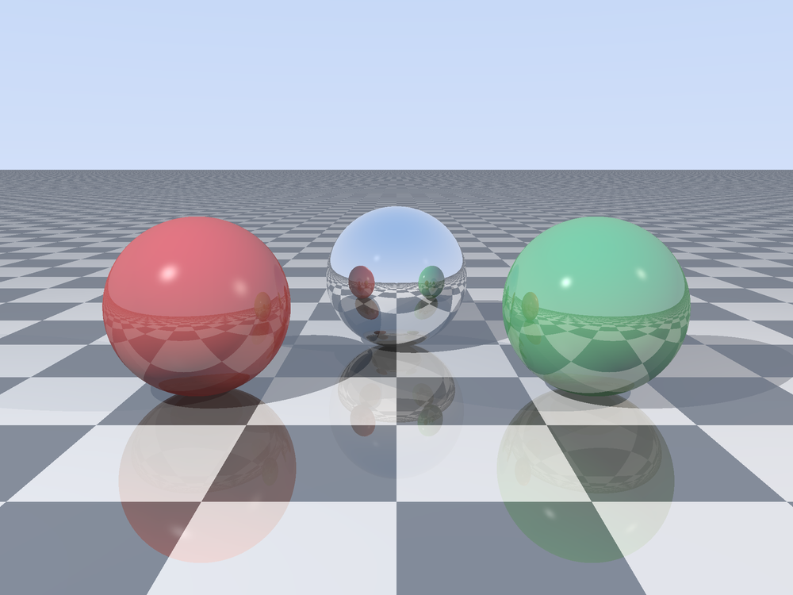

# Computer_Graph_Ray_Tracing

Proyecto final de Graficación por Computadora (agosto-diciembre 2026).
Renderizador implementado desde cero que calcula de forma analítica la interacción de la luz con esferas y planos.



## Características
- Cámara de perspectiva con base ortonormal y rayos primarios por píxel.
- Intersección analítica rayo-esfera y rayo-plano.
- Iluminación de Phong (ambiental, difusa y especular) con luces puntuales y atenuación.
- Rayos de sombra y reflexiones recursivas.
- Piso con patrón de tablero, antialiasing por supermuestreo y corrección gamma.
- Exportación a PNG.

## Tecnologías
Python 3, NumPy (cálculo vectorizado), Pillow (exportación de imagen), pytest.

## Integrantes
- Ortiz Martínez Isai Eliezer

## Instalación
```bash
pip install -r requirements.txt
```

## Ejecución
```bash
python main.py --scene mirror_spheres --width 1000 --height 750 --supersampling 2 --depth 4 --output renders/mirror_spheres.png
python -m pytest
```

## Estructura
| Módulo | Contenido |
|---|---|
| `raytracer/vectors.py` | normalización, producto punto, reflexión |
| `raytracer/camera.py` | generación de rayos primarios |
| `raytracer/primitives.py` | `Sphere`, `Plane` y sus intersecciones |
| `raytracer/materials.py` | propiedades de Phong y patrón de tablero |
| `raytracer/scene.py` | luces, fondo y contenedor de escena |
| `raytracer/renderer.py` | trazado recursivo, Phong, sombras |
| `raytracer/scenes.py` | escenas de ejemplo |
| `tests/` | pruebas de intersección, cámara y reflexión |

## Uso de herramientas de IA
Completar según la rúbrica: herramienta usada, para qué, y qué contribuciones fueron propias.

## Referencias
Shirley y Morley, *Realistic Ray Tracing*; Foley et al., *Computer Graphics: Principles and Practice*; Phong (1975).
